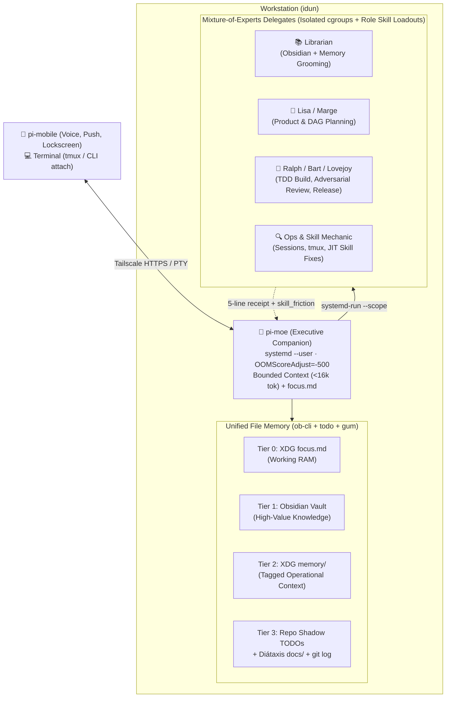

# pi-moe

> *"Welcome to Moe's. What can I get started for ya?"*

**`pi-moe`** is an always-on, memory-disciplined workstation companion and **Mixture-of-Experts (MoE)** delegate orchestrator for [`pi`](https://github.com/earendil-works/pi).

While Meta's *Muse* aims to be the creative catalyst, **Moe** is the dependable bartender behind the counter on your workstation: always reachable from your pocket via `pi-mobile`, never letting his own context window get out of hand, knowing where every repository and note lives, and routing real work to a focused cast of specialist agents (**Marge**, **Lisa**, **Ralph**, **Bart**, **Lovejoy**, and the **Librarian**).

---

## Core Design Principles

1. **Undistracted Executive + Mixture-of-Experts Delegates**
   - Inspired by [Augmented Coding Patterns](https://lexler.github.io/augmented-coding-patterns/) (*Focused Agent*, *Offload Deterministic*, *Memory Grooming*, *Learning Loop*).
   - **Moe (the Executive)** never runs noisy repo searches, 50-file reads, or test suites in his own context window. His context stays under a strict token budget (~15k tokens) so he remains sharp across weeks of continuous operation.
   - Heavy or specialized work is dispatched to **role-scoped delegates**—each booting with its own curated `skill-tiers.json` loadout so it is never distracted by irrelevant skills.

2. **Four-Tier Memory Without Database Bloat**
   - **Tier 0 — Active Focus (`focus.md`)**: Pinned in Moe's system prompt (~1k tokens) under `${XDG_STATE_HOME:-~/.local/state}/pi-moe/focus.md`. Holds current intent, active missions, and standing preferences. Updated at batch boundaries to preserve LLM prompt caching.
   - **Tier 1 — High-Value Durable Knowledge (Obsidian Vault)**: Curated by the **Librarian** delegate via `ob-cli --mode=obsidian`. Strict admission criteria: only enduring architectural insights, research syntheses, and cross-project ideas (`Incoming.md`, `_todo.md`).
   - **Tier 2 — Operational Context (XDG Memory)**: Tagged markdown files in `${XDG_STATE_HOME:-~/.local/state}/pi-moe/memory/` managed via `ob-cli --mode=memory`. Fast frontmatter/tag lookup without polluting the personal Obsidian vault.
   - **Tier 3 — Per-Repo Ground Truth**: Shadow task DAGs via `todo` (`todo-navigator`), repository discovery via `gum` (`git-repo-discovery`), Diátaxis `docs/`, and Conventional Commits (`git log`).

3. **OOM-Immune & Low-Maintenance (`systemd --user`)**
   - Moe runs as a lightweight `systemd --user` service with `OOMScoreAdjust=-500` and automatic restart.
   - All delegated coding/test runs execute inside isolated transient cgroups (`systemd-run --user --scope -p MemoryMax=... -p OOMScoreAdjust=500`) and isolated `git worktrees`. If a worker triggers the Linux OOM killer, only the worker scope dies; Moe catches the exit status and notifies you on `pi-mobile`.

4. **DWIM ("Do What I Mean") Determinism & JIT Skill Evolution**
   - Deterministic CLI tools (`ob-cli`, `gum`, `todo`, `sessions`) handle repeatable operations instead of LLM improvisation.
   - When a delegate encounters skill friction or has to improvise shell pipelines, it emits a structured `skill_friction` receipt so `agent-skills` can be improved Just-In-Time.

---

## Architecture Overview

---

## Documentation (Diátaxis)

- **Architecture & Explanation**: [`docs/explanation/architecture.md`](docs/explanation/architecture.md)
- **Memory & Grooming Model**: [`docs/explanation/memory-model.md`](docs/explanation/memory-model.md)
- **Mixture-of-Experts Loadouts**: [`docs/reference/delegate-loadouts.md`](docs/reference/delegate-loadouts.md)

## License

MIT
